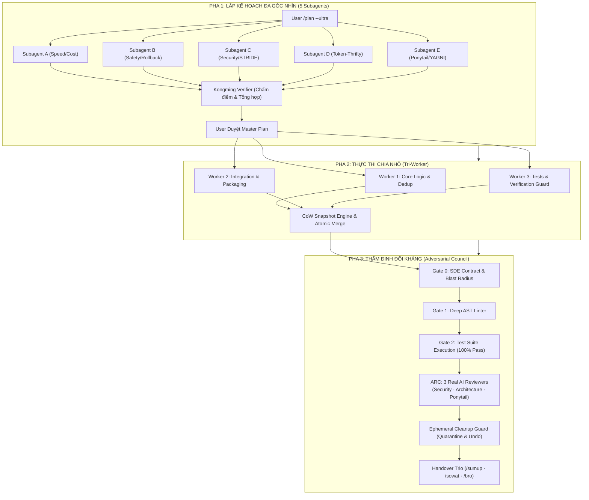

<div align="center">

# 🛡️ AgentKit Dual-Control Architecture

### Enterprise Multi-Agent Operating System & Omni-Skills Governance for AI Coding Assistants

[](https://github.com/vanlinh0392-art/agentkit-dual-control)
[](LICENSE)
[](https://python.org)
[](#-hệ-thống-12-plugins-chuyên-biệt-antigravity-20)
[](#-omni-skills-registry--inverted-intent-routing)
[](#-bộ-tứ-hệ-sinh-thái-hợp-lực-the-synergistic-quad-stack)

<br/>

> **"Runtime giữ máy — Skills giữ đầu lạnh"**  
> *(Runtime Guardrails enforce system stability — Cognitive Skills ensure deep, unhurried, adversarial reasoning)*

</div>

---

## 📖 Giới Thiệu (Overview v6.0)

**AgentKit Dual-Control (v6.0.0 Omni-Skills & 12 Plugins Edition)** là hệ điều hành tác tử kép cấp doanh nghiệp, được tối ưu hóa 100% cho **Google Antigravity 2.0**, **Gemini CLI** và các trợ lý AI lập trình thế hệ mới.

Trong phiên bản v6.0, AgentKit mở rộng mô hình kiểm soát kép bằng hệ thống **Omni-Skills Architecture**:
1. **Kiểm soát Tác tử Kép (Dual-Control Core):**
   - **Tầng 1 — Runtime Protocols (14 giao thức cứng):** Watchdog trần 15 phút, Pre-Response Cleanup Gate (diệt task/subagent mồ côi), khôi phục tức thì qua Copy-on-Write WAL (<5ms) và bộ cách ly rác kỹ thuật có thể hoàn tác (`undo-prune`).
   - **Tầng 2 — Cognitive Skills & Tri-Core Personas:** Tư duy 3 lớp (Deep Reasoning), Hội đồng phản biện đối kháng độc lập (Adversarial Review Council với 3 Subagent thật), phối hợp cùng bộ tứ kỹ năng tối ưu 60% – 90% token quota.
2. **Hệ thống 12 Plugins Chuyên biệt (Antigravity 2.0 Plugin Ecosystem):**
   - Đóng gói toàn bộ 320+ kỹ năng vào 12 plugins theo chuẩn mở của Google Antigravity.
   - Triển khai trực tiếp vào `~/.gemini/config/plugins/` giúp mở rộng năng lực toàn diện mà không gây nhiễu ngữ cảnh.
3. **Omni-Skills Registry & Inverted Intent Routing:**
   - Chỉ mục đảo ngược siêu nhẹ `skills_index.json` (<20KB) định tuyến tức thì 64+ ý định tự nhiên bằng tiếng Việt sang đúng skill/plugin tương ứng.
   - Kho lưu trữ Standalone Cold Storage (`registry/storage/`) bảo toàn 22 kỹ năng chuyên sâu.
4. **Bản sắc & Triết lý SOUL.md:**
   - Định hình phong cách Senior Staff Engineer & Pragmatic Pair Programmer: chống AI Slop, không giả định ngầm, gu thiết kế thẩm mỹ cao, và kỷ luật ngữ cảnh tuyệt đối.

---

## 🧩 Hệ Thống 12 Plugins Chuyên Biệt (Antigravity 2.0)

Toàn bộ năng lực chuyên sâu được cấu trúc hóa vào 12 plugin tiêu chuẩn trong thư mục `plugins/` (và tự động liên kết tới `~/.gemini/config/plugins/`):

| STT | Plugin Name | Vai Trò & Năng Lực Cốt Lõi |
| :---: | :--- | :--- |
| 1 | **android-cli-plugin** | Điều khiển Android qua CLI/ADB không dây, quản lý app & flows tương tác |
| 2 | **antigravity-kit-plugin** | Bộ công cụ mở rộng hệ sinh thái Antigravity, ruleset & workflows tích hợp |
| 3 | **chrome-devtools-plugin** | Tương tác & tự động hóa DevTools, phân tích console, network và DOM |
| 4 | **developer-power-skills** | Kỹ năng lập trình cấp cao: debug, refactor, Clean Code, design patterns |
| 5 | **elite-workflows-and-taste** | Quy trình phát triển tinh hoa, gu thẩm mỹ giao diện và tiêu chuẩn kỹ thuật |
| 6 | **firebase** | Quản trị Firebase backend, Firestore, Authentication và Cloud Functions |
| 7 | **google-antigravity-sdk** | SDK mở rộng chính thức cho Antigravity 2.0 API & agent integrations |
| 8 | **modern-web-guidance-plugin** | Hướng dẫn phát triển web hiện đại (React 19, Next.js, Vite, TypeScript) |
| 9 | **openspec-plugin** | Quản lý thay đổi phần mềm chuẩn OpenSpec (Propose, Apply, Verify, Archive) |
| 10 | **science** | Tính toán khoa học, phân tích dữ liệu, ma trận và thuật toán học thuật |
| 11 | **scientific-agent-skills** | Kỹ năng nghiên cứu khoa học chuyên sâu, phân tích cấu trúc, sinh học & y sinh |
| 12 | **social-media-skills** | Tối ưu hóa nội dung, visual marketing, thumbnail và chiến lược truyền thông |

---

## 🗺️ Omni-Skills Registry & Inverted Intent Routing

Không còn tình trạng nhồi nhét hàng trăm file mô tả skill vào system prompt gây tràn context. AgentKit v6.0 sử dụng mô hình **Dual-Registry**:

```
                       User Prompt (Tiếng Việt Tự Nhiên)
                                      │
                                      ▼
               ┌──────────────────────────────────────────────┐
               │  Inverted Intent Router (skills_index.json)  │
               │         (< 20KB · 67 Intents · O(1))         │
               └──────────────────────┬───────────────────────┘
                                      │
                     ┌────────────────┴────────────────┐
                     ▼                                 ▼
         [Plugins Hot-Loaded]              [Standalone Cold Storage]
         12 Plugins (~/.gemini)            22 Skills (registry/storage/)
```

- **Inverted Index (`registry/skills_index.json`):** Ánh xạ hơn 290 cụm từ tiếng Việt tự nhiên và 67 danh mục ý định sang chính xác skill/plugin đích trong thời gian $O(1)$.
- **Standalone Cold Storage (`registry/storage/`):** Chứa 22 kỹ năng chuyên biệt độc lập (WordPress, Cloudflare Agent, Health, Web Performance, Sandboxing...) chỉ tải khi được kích hoạt.

---

## ⚡ Bộ Tứ Hệ Sinh Thái Hợp Lực (The Synergistic Quad-Stack)

AgentKit Dual-Control kết nối chặt chẽ với **4 trụ cột công nghệ** nhằm tối đa hóa chất lượng code và tối ưu hóa tài nguyên:

```
┌────────────────────────────────────────────────────────────────────────┐
│                      AGENTKIT DUAL-CONTROL v6.0.0                      │
│        (14 Runtime Protocols · 12 Plugins · Omni-Skills Router)        │
└───────┬───────────────────┬───────────────────┬─────────────────┬──────┘
        │                   │                   │                 │
        ▼                   ▼                   ▼                 ▼
 ┌───────────────┐   ┌───────────────┐   ┌───────────────┐  ┌───────────────┐
 │      RTK      │   │   CodeGraph   │   │   Ponytail    │  │ Tech Advisor  │
 │ (Token Killer)│   │ (AST Graph)   │   │  (Lazy Senior)│  │ (Architecture)│
 └───────────────┘   └───────────────┘   └───────────────┘  └───────────────┘
```

### 1. ⚡ RTK (Rust Token Killer)
- **Vai trò:** Tự động nén và lọc output của mọi lệnh terminal (`git`, `npm`, `pytest`, `cargo`, `dir`...).
- **Hiệu quả:** Cắt giảm **50% – 99% token rác** từ stdout/stderr, ngăn chặn hoàn toàn tình trạng tràn ngữ cảnh.

### 2. 🔍 CodeGraph (v1.6.2 Engine)
- **Vai trò:** Đồ thị tri thức mã nguồn cục bộ (Local-First Semantic AST Graph) chạy bằng nhân Rust native cho 20+ ngôn ngữ.
- **Surgical Context:** Thay thế toàn bộ vòng lặp `grep` $\rightarrow$ `read file` tốn kém bằng **1 tool call duy nhất (`codegraph_explore`)**.
- **Hiệu quả:** Giảm **89% tool calls**, giảm **69% tokens**, **0 file reads thủ công**, và tính toán Blast Radius $O(1)$ tức thì.

### 3. 🪓 Ponytail Doctrine (The Lazy Senior Dev)
- **Vai trò:** Tư duy lập trình tối giản, diệt bloatware và over-engineering theo **Thang quyết định 7 bước (Decision Ladder)**:
  `YAGNI` $\rightarrow$ `Tái sử dụng` $\rightarrow$ `Stdlib` $\rightarrow$ `Native Platform` $\rightarrow$ `Dependency sẵn có` $\rightarrow$ `One-liner` $\rightarrow$ `Code tối thiểu`.
- **Sửa lỗi tận gốc (Root Cause):** Cấm tuyệt đối vá lớp vỏ (`try/catch` bọc ngoài, thêm `sleep`/`retry` né race condition, CSS `!important`). Bắt buộc trace ngược caller và fix tận nguồn phát sinh dữ liệu lỗi.

### 4. 👑 Technical Advisor (Principal Architect)
- **Vai trò:** Cố vấn kiến trúc cấp cao, bảo mật Zero-Trust và hiệu năng bền vững.
- **Tính năng:** Đánh giá rủi ro STRIDE Lite, vẽ Blast Radius 3 vùng màu (Đỏ - Vàng - Xanh), kiểm soát độ phức tạp thuật toán $O(N)$, loại bỏ triệt để $N+1$ queries.

---

## 🏗️ Kiến Trúc Quy Trình 3 Pha (5 $\rightarrow$ 3 $\rightarrow$ 1)

AgentKit vận hành theo quy trình phân tách trách nhiệm nghiêm ngặt nhằm đảm bảo mã nguồn sinh ra đạt chuẩn Zero-Defect:



---

## 🛡️ Hệ Thống Cổng Kiểm Soát (Quality Gates)

Mọi dòng code viết ra bắt buộc phải vượt qua các cổng kiểm soát tự động trước khi bàn giao:

| Cổng | Tên Cổng | Cơ Chế Kiểm Soát | Hành Động Khi Vi Phạm |
| :---: | :--- | :--- | :--- |
| **Gate 0** | **SDE Contract** | Quét phạm vi file sửa đổi, chặn 100% tình trạng Scope Creep | **Chặn ngay lập tức** |
| **Gate 0.5** | **Cross-Worker Contract** | Kiểm tra tương thích arity, chữ ký hàm giữa các worker | Chặn merge không khớp |
| **Gate 1** | **Deep AST Linter** | Phân tích AST bắt `bare except`, nuốt lỗi ngầm, rò rỉ tài nguyên | Bắt buộc sửa tận gốc |
| **Gate 2** | **Test Rigor** | Kiểm tra mật độ Assert Density ($\ge 2.0$), Mutation Kill Rate ($\ge 80\%$) | Bổ sung test cases |
| **Gate 2.5**| **Test Execution** | Chạy toàn bộ test suite thực tế của dự án | **FAIL-CLOSED:** Dừng pipeline |
| **Gate 3** | **ARC Review Council**| **3 Subagent AI thật** độc lập chấm điểm (Yêu cầu $\ge 8.0/10$, 0 Blocker) | Yêu cầu Remediation |

---

## 🧹 Ephemeral Cleanup Guard & Quarantine Engine

- **Zero-Pollution Rule:** Cấm tạo file tạm tại Workspace Root. Mọi kiểm thử phải dùng one-liner (`python -c`) hoặc thư mục scratch tự hủy.
- **Quarantine Soft-Delete:** File rác không bị xóa vĩnh viễn ngay mà được đưa vào `.agentkit/trash/<tx_id>/` kèm nhật ký `wal.json`.
- **Hoàn Tác 1 Giây (`undo-prune`):** Khôi phục nguyên trạng file bị dọn dẹp nhầm:
  ```powershell
  python scripts/cleanup_guard.py undo-prune --tx <transaction_id>
  ```
- **Secure Shredding:** Ghi đè byte `0x00` trước khi xóa vĩnh viễn các file nhạy cảm.

---

## 🚀 Hướng Dẫn Cài Đặt Siêu Tốc (Quick Install)

### Cách 1: Cài đặt 1-chạm qua PowerShell (Khuyên dùng cho Windows & Antigravity 2.0)

Mở PowerShell và chạy lệnh sau:

```powershell
irm https://raw.githubusercontent.com/vanlinh0392-art/agentkit-dual-control/main/install.ps1 | iex
```

*Script sẽ tự động:*
1. Clone / cập nhật repo vào `%USERPROFILE%\.gemini\config\skills\agentkit-dual-control`.
2. Kiểm tra Python 3.10+, Git, RTK, CodeGraph.
3. **Triển khai 12 Plugins:** Tự động đồng bộ 12 plugins vào `%USERPROFILE%\.gemini\config\plugins\`.
4. **Đồng bộ Doctrines fix cứng:** Nạp trực tiếp toàn bộ các Doctrine cốt lõi từ `GEMINI.md` vào `~/.gemini/GEMINI.md` kèm bảng Router 64+ intents tiếng Việt.
5. **Kiểm tra Omni-Skills Registry:** Xác thực `skills_index.json` và kho lưu trữ standalone.
6. Chạy `health_check.py` kiểm chứng toàn bộ hệ thống.

---

### Cách 2: Cài đặt 1-chạm qua Bash (Linux / macOS)

```bash
curl -fsSL https://raw.githubusercontent.com/vanlinh0392-art/agentkit-dual-control/main/install.sh | bash
```

---

### Cách 3: Cài đặt thủ công (Manual Setup)

```bash
# 1. Clone repository
mkdir -p ~/.gemini/config/skills
git clone https://github.com/vanlinh0392-art/agentkit-dual-control.git ~/.gemini/config/skills/agentkit-dual-control

# 2. Triển khai 12 Plugins
mkdir -p ~/.gemini/config/plugins
cp -r ~/.gemini/config/skills/agentkit-dual-control/plugins/* ~/.gemini/config/plugins/

# 3. Đồng bộ Rule fix cứng vào ~/.gemini/GEMINI.md
cp ~/.gemini/config/skills/agentkit-dual-control/GEMINI.md ~/.gemini/GEMINI.md

# 4. Kiểm tra toàn vẹn hệ thống
cd ~/.gemini/config/skills/agentkit-dual-control
python scripts/health_check.py
```

---

## 📜 Các Quy Tắc Fix Cứng Trong `GEMINI.md` (System Doctrines)

| Doctrine | Mục đích cốt lõi |
| :--- | :--- |
| **🧠 Pro Max Reasoning** | Ép model luôn chạy ở High Reasoning (`Model: 'inherit'`), cấm dùng model yếu cho các tác vụ lập luận. |
| **🛡️ Dual-Control Doctrine** | Trần 15 phút + Watchdog bắt buộc, Pre-Response Cleanup Gate (diệt task/subagent mồ côi), Complexity Gating (Tri-Worker khi $\ge 4$ files). |
| **👑 Technical Advisor** | Đánh giá rủi ro STRIDE Lite, vẽ Blast Radius 3 vùng màu, kiểm soát $O(N)$ và triệt tiêu $N+1$ query. |
| **🪓 Ponytail Doctrine** | Thang quyết định 7 bước (YAGNI), sửa lỗi tận gốc (cấm vá lớp vỏ), Zero-Pollution Workspace (cấm tạo probe script tại root). |
| **⚡ RTK Doctrine** | Bắt buộc đặt tiền tố `rtk` trước mọi lệnh shell để nén 50% – 99% token. |
| **🔍 CodeGraph Doctrine** | Tự động nhận diện `.codegraph/`, ép dùng `codegraph_explore` thay vì grep thủ công. |
| **🎯 Natural Intent Router** | Tự động phân loại 64+ ý định tự nhiên bằng tiếng Việt sang đúng skill/plugin chuyên môn. |

---

## 🧪 Kiểm Thử Toàn Diện (Test Suite)

AgentKit Dual-Control đi kèm bộ kiểm thử hồi quy khắt khe:

```powershell
python scripts/test_agentkit.py
```

---

## 📂 Cấu Trúc Thư Mục (Directory Layout v6.0)

```text
agentkit-dual-control/
├── config.yaml               # Cấu hình trung tâm (Gates, Thresholds, Plugins, Registry, Timeouts)
├── SKILL.md                  # Bản đồ giao thức điều hướng cho AI Coding Assistant
├── GEMINI.md                 # Quy tắc fix cứng toàn cục & Intent Router 64+ tiếng Việt
├── SOUL.md                   # Bản sắc kỹ sư Senior Staff & Triết lý kỹ thuật
├── README.md                 # Tài liệu hướng dẫn sử dụng & kiến trúc v6.0
├── LICENSE                   # Giấy phép nguồn mở MIT
├── install.ps1               # Script cài đặt 1-click cho Windows PowerShell (Antigravity 2.0)
├── install.sh                # Script cài đặt 1-click cho Linux / macOS
├── plugins/                  # 12 Plugins chuyên biệt đóng gói cho Google Antigravity
│   ├── android-cli-plugin/
│   ├── antigravity-kit-plugin/
│   ├── chrome-devtools-plugin/
│   ├── developer-power-skills/
│   ├── elite-workflows-and-taste/
│   ├── firebase/
│   ├── google-antigravity-sdk/
│   ├── modern-web-guidance-plugin/
│   ├── openspec-plugin/
│   ├── science/
│   ├── scientific-agent-skills/
│   └── social-media-skills/
├── registry/                 # Hệ thống định tuyến & lưu trữ kỹ năng Omni-Skills
│   ├── skills_index.json     # Inverted Intent Router (<20KB, 67 intents, 290+ triggers)
│   └── storage/              # Kho lưu trữ 22 Standalone skills chuyên biệt
├── references/               # Tài liệu chi tiết các phân tầng
│   ├── protocols.md          # 14 Runtime Protocols chi tiết
│   ├── sidecar_matrix.md     # Ma trận Sidecars & 7 Vector tấn công của Skeptic
│   ├── cli_engines.md        # Hướng dẫn tích hợp RTK & CodeGraph
│   └── safe_vocabulary.yaml  # Bảng từ vựng an toàn (Content Filter Safety)
└── scripts/                  # Bộ công cụ thực thi tự động (Python Stdlib First)
    ├── cleanup_guard.py      # Dọn dẹp rác kỹ thuật & Quarantine Soft-Delete
    ├── code_guard.py         # Deep AST Linter & WAL Snapshot
    ├── content_filter.py     # Content Filter & Prompt Sanitizer
    ├── cow_engine.py         # Copy-on-Write Filesystem Snapshot & Multi-File WAL
    ├── decision_log.py       # Nhật ký quyết định kiến trúc
    ├── health_check.py       # Kiểm tra toàn vẹn hệ thống
    ├── lessons.py            # Quản lý bài học kinh nghiệm 2 tầng
    ├── metrics.py            # Đo lường & thống kê hiệu suất
    ├── orchestrate_engine.py # Điều phối Tri-Worker & ARC Review Council
    ├── sde_guard.py          # Kiểm soát Scope Creep (Gate 0)
    ├── security_guard.py     # Quét Zero-Trust Secrets
    ├── task_watchdog.py      # Watchdog chống treo lệnh nền
    ├── test_guard.py         # Kiểm tra Rigor & Mutation Testing Lite
    ├── worktree_gc.py        # Dọn dẹp Git Worktrees
    ├── test_agentkit.py      # Bộ kiểm thử tích hợp toàn diện
    └── _shared.py            # Thư viện dùng chung (DRY Module)
```

---

## 👤 Tác Giả & Bản Quyền (Author & License)

- **Tác giả:** [vanlinh0392-art](https://github.com/vanlinh0392-art)
- **Giấy phép:** Được phát hành theo [MIT License](LICENSE).
