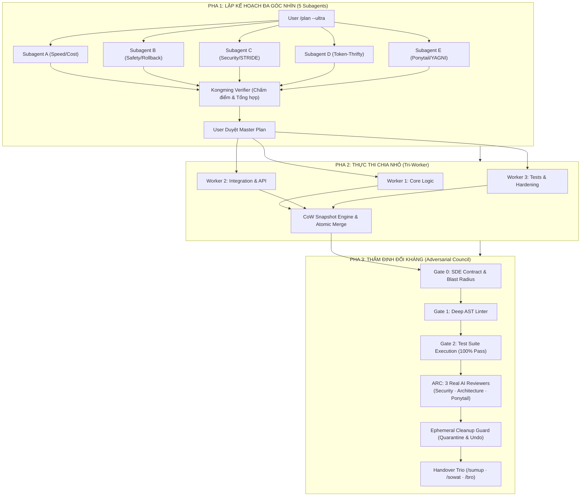

<div align="center">

# 🛡️ AgentKit Dual-Control Architecture

### Enterprise Multi-Agent Operating System & Cognitive Governance for AI Coding Assistants

[](https://github.com/vanlinh0392-art/agentkit-dual-control)
[](LICENSE)
[](https://python.org)
[-brightgreen?style=for-the-badge&logo=checkmarx&logoColor=white)](#kiểm-thử-toàn-diện)
[](#bộ-tứ-hệ-sinh-thái-hợp-lực-the-synergistic-quad-stack)

<br/>

> **"Runtime giữ máy — Skills giữ đầu lạnh"**  
> *(Runtime Guardrails enforce system stability — Cognitive Skills ensure deep, unhurried, adversarial reasoning)*

</div>

---

## 📖 Giới Thiệu (Overview)

**AgentKit Dual-Control (v5.5.0)** là hệ thống kiểm soát tác tử kép (Dual-Control Architecture) cấp doanh nghiệp, được thiết kế chuyên biệt cho **Google Antigravity**, **Gemini CLI** và các trợ lý AI lập trình tiên tiến.

Khi lập trình tự động với AI, hai rủi ro lớn nhất thường gặp là:
1. **Mất kiểm soát hệ thống (Runtime Drift):** Lệnh treo vô hạn, spam hàng chục tiến trình nền, rò rỉ file rác/debug khắp dự án, hoặc chỉnh sửa lan man ra ngoài phạm vi (Scope Creep).
2. **Ảo giác & Vá lỗi bề mặt (Superficial Patching):** AI tự đồng ý với chính mình, che đậy lỗi bằng `try/except pass`, không phân tích nguyên nhân gốc rễ, và lãng phí token qua các vòng lặp grep vô tận.

**AgentKit Dual-Control** giải quyết triệt để vấn đề này bằng mô hình **Kiểm soát 2 Tầng (Dual-Control)**:
- **Tầng 1 — Runtime Protocols (14 giao thức cứng):** Giám sát tiến trình, dọn dẹp tài nguyên, kiểm soát thời gian chờ (Watchdog trần 15 phút), khôi phục tức thì qua Copy-on-Write WAL (<5ms) và dọn dẹp rác kỹ thuật có thể hoàn tác (`undo-prune`).
- **Tầng 2 — Cognitive Skills (Tư duy sâu 3 pha):** Lập luận 3 lớp (Deep Reasoning), Hội đồng phản biện đối kháng độc lập (Adversarial Review Council với 3 Subagent thật), cùng bộ tứ kỹ năng hợp lực giúp cắt giảm 60% – 90% chi phí Token.

---

## ⚡ Bộ Tứ Hệ Sinh Thái Hợp Lực (The Synergistic Quad-Stack)

AgentKit Dual-Control không hoạt động đơn độc mà kết nối chặt chẽ với **4 trụ cột công nghệ** nhằm tối đa hóa chất lượng code và tối ưu hóa tài nguyên:

```
┌────────────────────────────────────────────────────────────────────────┐
│                      AGENTKIT DUAL-CONTROL v5.5.0                      │
│        (14 Runtime Protocols · 5 Automated Gates · CoW Engine)         │
└───────┬───────────────────┬───────────────────┬─────────────────┬──────┘
        │                   │                   │                 │
        ▼                   ▼                   ▼                 ▼
 ┌───────────────┐   ┌───────────────┐   ┌───────────────┐  ┌───────────────┐
 │      RTK      │   │   CodeGraph   │   │   Ponytail    │  │ Tech Advisor  │
 │ (Token Killer)│   │ (AST Graph)   │   │  (Lazy Senior)│  │ (Architecture)│
 └───────────────┘   └───────────────┘   └───────────────┘  └───────────────┘
```

### 1. ⚡ RTK (Rust Token Killer)
- **Vai trò:** Tự động nén và lọc output của mọi lệnh terminal (`git`, `npm`, `pytest`, `cargo`, `dir`...).
- **Hiệu quả:** Cắt giảm **50% – 99% token rác** từ stdout/stderr, ngăn chặn hoàn toàn tình trạng tràn ngữ cảnh (Context Overflow).

### 2. 🔍 CodeGraph (v1.6.2 Engine)
- **Vai trò:** Đồ thị tri thức mã nguồn cục bộ (Local-First Semantic AST Graph) chạy bằng nhân Rust native cho 20+ ngôn ngữ.
- **Surgical Context:** Thay thế toàn bộ vòng lặp `grep` $\rightarrow$ `read file` tốn kém bằng **1 tool call duy nhất (`codegraph_explore`)**.
- **Hiệu quả:** Giảm **89% tool calls**, giảm **69% tokens**, **0 file reads thủ công**, và tính toán Blast Radius $O(1)$ tức thì.

### 3. 🪓 Ponytail Doctrine (The Lazy Senior Dev)
- **Vai trò:** Tư duy lập trình tối giản, diệt bloatware và over-engineering theo **Thang quyết định 7 bước (Decision Ladder)**:
  `YAGNI` $\rightarrow$ `Tái sử dụng` $\rightarrow$ `Stdlib` $\rightarrow$ `Native Platform` $\rightarrow$ `Dependency sẵn có` $\rightarrow$ `One-liner` $\rightarrow$ `Code tối thiểu`.
- **Sửa lỗi tận gốc (Root Cause):** Cấm tuyệt đối vá lớp vỏ (`try/catch` bọc ngoài, thêm `sleep`/`retry` né race condition, CSS `!important`). Bắt buộc trace ngược caller và fix tận nguồn phát sinh dữ liệu lỗi.

### 4. 👑 Technical Advisor (Principal Architect)
- **Vai trò:** Cố vấn kiến trúc cấp cao, bảo mật Zero-Trust và hiệu năng bền vững.
- **Tính năng:** Đánh giá rủi ro STRIDE Lite, vẽ Blast Radius 3 vùng màu (Đỏ - Vàng - Xanh), kiểm soát độ phức tạp thuật toán $O(N)$, loại bỏ triệt để $N+1$ queries.

---

## 🏗️ Kiến Trúc Quy Trình 3 Pha (5 $\rightarrow$ 3 $\rightarrow$ 1)

AgentKit vận hành theo quy trình phân tách trách nhiệm nghiêm ngặt nhằm đảm bảo mã nguồn sinh ra đạt chuẩn Zero-Defect:



---

## 🛡️ Hệ Thống 5 Cổng Kiểm Soát (5-Gate Pipeline)

Mọi dòng code viết ra bắt buộc phải vượt qua 5 cổng kiểm soát tự động trước khi bàn giao:

| Cổng | Tên Cổng | Cơ Chế Kiểm Soát | Hành Động Khi Vi Phạm |
| :---: | :--- | :--- | :--- |
| **Gate 0** | **SDE Contract** | Quét phạm vi file sửa đổi, chặn 100% tình trạng Scope Creep | **Chặn ngay lập tức** |
| **Gate 1** | **Deep AST Linter** | Phân tích AST bắt `bare except`, nuốt lỗi ngầm, rò rỉ tài nguyên | Bắt buộc sửa tận gốc |
| **Gate 2** | **Test Rigor** | Kiểm tra mật độ Assert Density ($\ge 2.0$), Mutation Kill Rate ($\ge 80\%$) | Bổ sung test cases |
| **Gate 2.5**| **Test Execution** | Chạy toàn bộ test suite thực tế của dự án | **FAIL-CLOSED:** Dừng pipeline |
| **Gate 3** | **ARC Review Council**| **3 Subagent AI thật** độc lập chấm điểm (Yêu cầu $\ge 8.0/10$, 0 Blocker) | Yêu cầu Remediation |

---

## 🧹 Ephemeral Cleanup Guard & Quarantine Engine

Không còn tình trạng AI tạo hàng tá script nháp (`inspect_*.py`, `probe_*.py`) gây ô nhiễm thư mục dự án:
- **Zero-Pollution Rule:** Cấm tạo file tạm tại Workspace Root. Mọi kiểm thử phải dùng one-liner (`python -c`) hoặc thư mục nháp tự hủy.
- **Quarantine Soft-Delete:** File rác không bị xóa vĩnh viễn ngay mà được đưa vào `.agentkit/trash/<tx_id>/` kèm nhật ký `wal.json`.
- **Hoàn Tác 1 Giây (`undo-prune`):** Nếu lỡ tay dọn nhầm, chỉ cần gõ 1 lệnh để khôi phục nguyên trạng:
  ```powershell
  python scripts/cleanup_guard.py undo-prune --tx <transaction_id>
  ```
- **Secure Shredding:** Ghi đè byte `0x00` trước khi xóa vĩnh viễn các file chứa token, key hoặc mật khẩu nhạy cảm.

---

## 🚀 Hướng Dẫn Cài Đặt Siêu Tốc (Quick Install)

### Cách 1: Cài đặt 1-chạm qua PowerShell (Khuyên dùng cho Windows)

Mở PowerShell và chạy lệnh sau:

```powershell
irm https://raw.githubusercontent.com/vanlinh0392-art/agentkit-dual-control/main/install.ps1 | iex
```

*Script sẽ tự động:*
1. Clone repo vào `%USERPROFILE%\.gemini\config\skills\agentkit-dual-control`.
2. Kiểm tra Python 3.10+, Git, RTK, CodeGraph.
3. **Đồng bộ tự động các Rule & Doctrine fix cứng:** Nạp trực tiếp toàn bộ các Doctrine cốt lõi từ `GEMINI.md` vào `~/.gemini/GEMINI.md` của bạn (kèm sao lưu tự động).
4. Chạy `health_check.py` kiểm chứng toàn bộ 19 module.
5. Sẵn sàng hoạt động ngay lập tức trên Antigravity / Gemini CLI.

---

### Cách 2: Cài đặt 1-chạm qua Bash (Linux / macOS)

```bash
curl -fsSL https://raw.githubusercontent.com/vanlinh0392-art/agentkit-dual-control/main/install.sh | bash
```

---

### Cách 3: Cài đặt thủ công (Manual Git Clone)

```bash
# 1. Di chuyển vào thư mục skills của Antigravity/Gemini
mkdir -p ~/.gemini/config/skills
cd ~/.gemini/config/skills

# 2. Clone repository
git clone https://github.com/vanlinh0392-art/agentkit-dual-control.git

# 3. Đồng bộ file Rule fix cứng vào ~/.gemini/GEMINI.md
cp agentkit-dual-control/GEMINI.md ~/.gemini/GEMINI.md

# 4. Kiểm tra tính toàn vẹn hệ thống
cd agentkit-dual-control
python scripts/health_check.py
```

---

## 📜 Các Quy Tắc Fix Cứng Trong `GEMINI.md` (System Doctrines)

Để đảm bảo AI luôn tuân thủ kỷ luật nghiêm ngặt mà không phụ thuộc vào ngữ cảnh hội thoại, AgentKit đóng gói sẵn toàn bộ các **Doctrines fix cứng** trong `GEMINI.md`:

| Doctrine | Mục đích cốt lõi |
| :--- | :--- |
| **🧠 Pro Max Reasoning** | Ép model luôn chạy ở High Reasoning (`Model: 'inherit'`), cấm dùng model yếu cho các tác vụ lập luận. |
| **🛡️ Dual-Control Doctrine** | Trần 15 phút + Watchdog bắt buộc, Pre-Response Cleanup Gate (diệt task/subagent mồ côi), Complexity Gating (Tri-Worker khi $\ge 4$ files). |
| **👑 Technical Advisor** | Đánh giá rủi ro STRIDE Lite, vẽ Blast Radius 3 vùng màu, kiểm soát $O(N)$ và triệt tiêu $N+1$ query. |
| **🪓 Ponytail Doctrine** | Thang quyết định 7 bước (YAGNI), sửa lỗi tận gốc (cấm vá lớp vỏ), Zero-Pollution Workspace (cấm tạo probe script tại root). |
| **⚡ RTK Doctrine** | Bắt buộc đặt tiền tố `rtk` trước mọi lệnh shell để nén 50% – 99% token. |
| **🔍 CodeGraph Doctrine** | Tự động nhận diện `.codegraph/`, ép dùng `codegraph_explore` thay vì grep thủ công. |

---

## 🧪 Kiểm Thử Toàn Diện (Test Suite)

AgentKit Dual-Control đi kèm bộ kiểm thử hồi quy khắt khe với **23 nhóm test suite**:

```powershell
python scripts/test_agentkit.py
```

**Kết quả kiểm chuẩn thực tế:**
```text
============================================================
📊 Results: 250/250 passed, 0 failed, 0 warnings
✅ ALL TESTS PASSED — ANTIGRAVITY v5.0.0 ADVERSARIAL ZERO-DEFECT DEFENSE HARDENED
============================================================
```

---

## 📂 Cấu Trúc Thư Mục (Directory Layout)

```text
agentkit-dual-control/
├── config.yaml               # Cấu hình trung tâm (Gates, Thresholds, Quarantine, Timeouts)
├── SKILL.md                  # Bản đồ giao thức điều hướng cho AI Coding Assistant
├── GEMINI.md                 # Quy tắc fix cứng toàn cục (Doctrines: Dual-Control, Ponytail, RTK, CodeGraph)
├── README.md                 # Tài liệu hướng dẫn sử dụng & kiến trúc
├── LICENSE                   # Giấy phép nguồn mở MIT
├── install.ps1               # Script cài đặt 1-click cho Windows PowerShell
├── install.sh                # Script cài đặt 1-click cho Linux / macOS
├── references/               # Tài liệu chi tiết các phân tầng
│   ├── protocols.md          # 14 Runtime Protocols chi tiết
│   ├── sidecar_matrix.md     # Ma trận Sidecars & 7 Vector tấn công của Skeptic
│   ├── cli_engines.md        # Hướng dẫn tích hợp RTK & CodeGraph
│   └── safe_vocabulary.yaml  # Bảng từ vựng an toàn (Content Filter Safety)
└── scripts/                  # Bộ công cụ thực thi tự động (Python Stdlib First)
    ├── cleanup_guard.py      # Dọn dẹp rác kỹ thuật & Quarantine Soft-Delete
    ├── code_guard.py         # Deep AST Linter & WAL Snapshot
    ├── content_filter.py     # Content Filter & Prompt Sanitizer
    ├── cow_engine.py         # Copy-on-Write Filesystem Snapshot & Multi-File WAL
    ├── decision_log.py       # Nhật ký quyết định kiến trúc
    ├── health_check.py       # Kiểm tra toàn vẹn hệ thống
    ├── lessons.py            # Quản lý bài học kinh nghiệm 2 tầng
    ├── metrics.py            # Đo lường & thống kê hiệu suất
    ├── orchestrate_engine.py # Điều phối Tri-Worker & ARC Review Council
    ├── sde_guard.py          # Kiểm soát Scope Creep (Gate 0)
    ├── security_guard.py     # Quét Zero-Trust Secrets
    ├── task_watchdog.py      # Watchdog chống treo lệnh nền
    ├── test_guard.py         # Kiểm tra Rigor & Mutation Testing Lite
    ├── worktree_gc.py        # Dọn dẹp Git Worktrees
    ├── test_agentkit.py      # Bộ kiểm thử tích hợp 250 test cases
    └── _shared.py            # Thư viện dùng chung (DRY Module)
```

---

## 👤 Tác Giả & Bản Quyền (Author & License)

- **Tác giả:** [vanlinh0392-art](https://github.com/vanlinh0392-art)
- **Giấy phép:** Được phát hành theo [MIT License](LICENSE).
