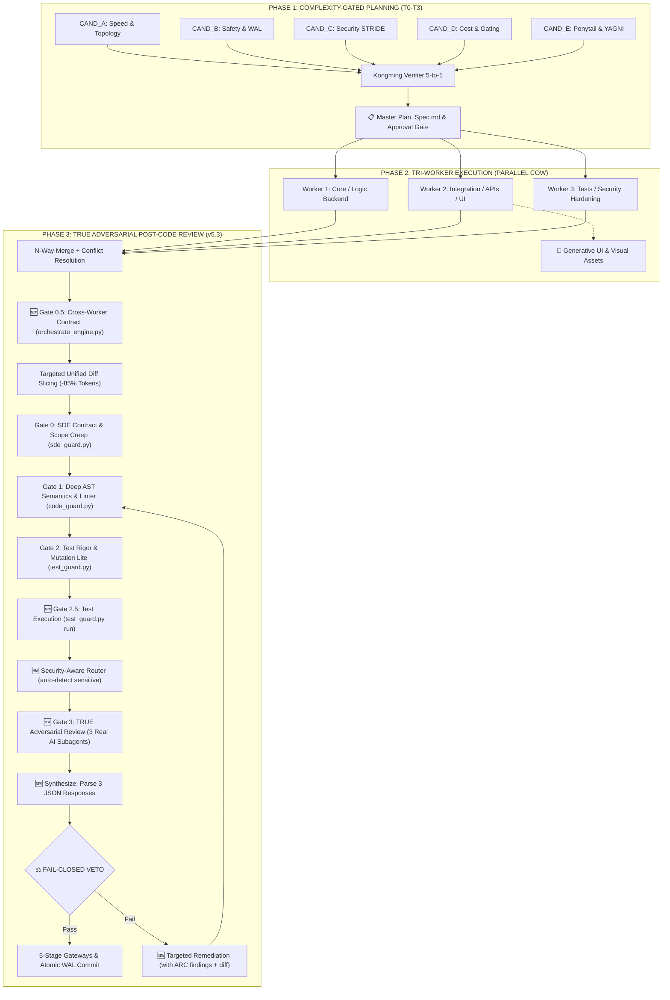

# 🛡️ AGENTKIT DUAL-CONTROL ARCHITECTURE v5.5 (TRUE ADVERSARIAL REVIEW EDITION)

> **Triết lý nền tảng:** *"Runtime giữ máy. Skills giữ đầu lạnh. Tri-Core tinh gọn diệt bloatware. Real AI Reviewers triệt tiêu self-review bias."*  
> Một AI agent tự nghĩ, tự review và tự duyệt code trong một lượt duy nhất là công thức sinh ra lỗi ngầm. AgentKit thiết lập rào chắn 2 tầng độc lập: cô lập hạ tầng thực thi bên dưới (CoW Sandbox, WAL Snapshots, Zero-Trust Gate) và phân vai chuyên biệt theo quy trình phát triển phần mềm chuẩn mực bên trên — v5.3 bổ sung **True Adversarial Review** bằng 3 AI subagents thực sự độc lập thay vì self-review dict JSON.

---

## 🏛️ LAYER 01: HẠ TẦNG THỰC THI & RÀO CHẮN RUNTIME (14 GIAO THỨC)

*Chi tiết toàn văn 14 giao thức (bao gồm §12 Content Filter Safety và §14 Cleanup Guard): xem [`references/protocols.md`](references/protocols.md)*

1. **Job Supervision & Anti-Hang Watchdog (TRẦN 15 PHÚT & PRE-RESPONSE CLEANUP GATE):** `WaitMsBeforeAsync` tối đa 30s; chạy async → BẮT BUỘC đặt `schedule` watchdog (900s, kill nếu treo). PRE-RESPONSE CLEANUP GATE: gọi `manage_task(list)` + `manage_subagents(list)` dọn mồ côi.
2. **Worktree & CoW Snapshot Isolation:** Phân bổ CoW sandbox siêu tốc qua `scripts/cow_engine.py` (tiết kiệm 95%-99.8% SSD), dọn branch qua `scripts/worktree_gc.py`, hỗ trợ tiền tố Windows Long-Path (`\\?\`).
3. **5-Stage Sequential Safety Gateways & Transactional WAL:** Kiểm toán cú pháp AST (`scripts/code_guard.py`), Blast-Radius 3 vùng màu, Ephemeral Sandbox smoke test và Multi-File WAL rollback <5ms.
4. **Security Zero-Trust & Probes Generator:** Quét rò rỉ secret và sinh test SQLi, IDOR, Auth Boundary qua `scripts/security_guard.py`.
4b. **Dependency & Supply Chain Audit:** Quét requirements/package.json phát hiện typosquat, unpinned versions qua `scripts/security_guard.py audit-deps`.
5. **Error Recovery Protocol (L1/L2/L3):** L1 Self-Heal (tối đa 3 lần, Micro-Snapshot rollback qua `scripts/code_guard.py`) $\rightarrow$ L2 Pivot $\rightarrow$ L3 Escalate to User qua `ask_question`.
6. **SDE Contract & Scope Creep Barrier:** Đối soát 100% Acceptance Criteria Gherkin và chặn sửa ngoài `target_files` qua `scripts/sde_guard.py`.
7. **Adversarial Test Rigor & Mutation Testing Lite:** Cấm Mock-the-SUT, bắt buộc Assert Density $\ge 2.0$ và Mutation Kill Rate $\ge 80\%$ trong <3s qua `scripts/test_guard.py`.
8. **Deep AST Semantics & Polyglot Linter Gate:** Bắt bare except, swallowed errors, missing returns, resource leaks qua `scripts/code_guard.py lint`.
9. **Adversarial Review Council & Fail-Closed Veto:** Hội đồng 3 bên (*Security Auditor, Technical Architect, Ponytail Dev*) phủ quyết qua `scripts/orchestrate_engine.py review-council`.
10. **Closed-Loop Remediation Cycle:** Sinh Ticket SRT, phân lập CoW Sandbox, WAL micro-checkpoint, tự vá tận gốc rễ tối đa 3 vòng L1.
11. **Token-Thrifty Unified Diff Slicing:** Cắt lát diff 7 dòng context window và áp dụng Complexity Gating 3 tầng (giảm 85%–95% tokens).
12. **Content Filter Safety Protocol (PROMPT SANITIZATION):** Khi dispatch subagent, LUÔN dùng ngôn ngữ kỹ thuật trung lập — tham chiếu skill path thay vì hành vi nhạy cảm ([`references/protocols.md`](references/protocols.md) §12).
13. **Full Execution Protocol:** Tác vụ theo skill chuyên biệt thực thi toàn bộ pipeline liên tục theo blueprint — phân tích $\rightarrow$ sửa $\rightarrow$ đóng gói $\rightarrow$ ký $\rightarrow$ deploy (fallback $\ge 3$ lần).
14. **Post-Task Ephemeral Cleanup & Zero-Bloat GC:** Quét dọn tệp tạm, scratch scripts, *.bak, snapshot WAL commit và cache qua `scripts/cleanup_guard.py` trước Handover Trio.

---

## 🧠 LAYER 02A: GIAO THỨC SUY LUẬN SÂU MẶC ĐỊNH (DEEP REASONING PROTOCOL - LUÔN BẬT)

> **Luôn tự động thực thi trong chuỗi suy nghĩ (Chain-of-Thought) trên MỌI tác vụ.** Khi dispatch subagents lập luận, LUÔN ưu tiên `Model: 'inherit'` (hoặc `pro`).

### Lớp 1 — Hiểu Đúng Bài Toán (Problem Framing & Pre-Flight Guards)
* **Pre-Flight Guards & CodeGraph:** Bắt buộc prefix `rtk` cho mọi lệnh shell, tra cứu tri thức 2 tầng (`scripts/lessons.py search`). Với repo có $\ge 5$ files mã nguồn: chủ động đề xuất hoặc chạy `codegraph init`. Khi đã có `.codegraph/`, BẮT BUỘC gọi `codegraph_explore` (truyền `projectPath`) trước mọi grep/view_file và dùng `codegraph impact <symbol>` để xác định Blast Radius cho Technical Advisor.

### Lớp 2 — Phản Biện Nội Tại (Self-Adversarial & Confidence Rubric)
* Tự vặn hỏi: "Giải pháp có thể sai ở đâu?", "Có cách nào đơn giản hơn (Ponytail)?".
* **Confidence Rubric:** Tool confirmed (+2), Test passed (+2), Spec (+1), Heuristic (+1), Complex chain (-1), Unknown (-2). *(Tổng $\ge 5$: High, 3–4: Medium, $\le 2$: Low).*

### Lớp 3 — Kiểm Chứng Trước Khi Giao (Pre-Delivery Verification)
* Đối soát: Nhất quán logic, Đầy đủ yêu cầu, Actionable cho người dùng.
* **Session Flush:** AI lưu tạm decisions trong bộ nhớ và tự động flush 1 lần khi kết phiên: `python scripts/decision_log.py flush --data '[...]'`.

---

## ⚖️ LAYER 02B: TRỌNG TÀI QUYẾT ĐỊNH & QUY TRÌNH 3 PHA (5 $\rightarrow$ 3 $
ightarrow$ 1)

### 1. Pha 1: Lập Kế Hoạch Đa Góc Nhìn (Complexity-Gated Plan Subagents)
* **⚠️ PRE-CODING COMPLEXITY GATE:** Trước khi code, BẮT BUỘC liệt kê `target_files` $\rightarrow$ xác định Tầng Complexity. Khi ở chế độ `/plan`, sau duyệt plan: T0 ($\le 1$ file, in-process OK); T1 (2-3 files, $\ge 1$ worker); T2 (4-10 files, bắt buộc **3 workers song song** Tri-Worker); T3 ($> 10$ files / Auth / DB, 5-9 subagents). *(Coding thường: in-process OK).*
* **T2-T3 Bắt Buộc Subagent Thật:** KHÔNG mô phỏng in-process. `Model: 'inherit'`.
* **Kongming Verifier & Adaptive Rubric:** Chấm điểm PLAN (Completeness 0.30, Correctness 0.25, Security 0.20, Efficiency 0.15, Simplicity 0.10) $\rightarrow$ Chọn phương án tối ưu hoặc Complementary Synthesis $\rightarrow$ Chờ duyệt.
* **HARD FLOOR RULE & Variance Penalty:** Tiêu chí Core $< 5.0$ $\rightarrow$ **DISQUALIFIED**. Variance $\ge 6.0$ $\rightarrow$ trừ 0.5 điểm. Rate-Limit 429: fallback in-process chỉ cho non-Plan.

### 2. Pha 2: Thực Thi Chia Nhỏ (Tri-Worker Execution — 3 Subagents)
* **Sau khi User duyệt Plan:** Chia nhỏ đầu việc và dispatch **3 worker subagents song song** (`Model: 'inherit'`, `TypeName: 'self'`): Worker 1 (Core/Logic), Worker 2 (Integration/UI), Worker 3 (Tests/Hardening).

### 3. Pha 3: Thẩm Định Đối Kháng Thật Sự & Rào Chắn Siêu Cấp (True Adversarial Review Council v5.3)
* **True Adversarial Review (3 AI Subagents Thật) & 5 Cổng Kiểm soát:**
  0. **Gate 0.5 (Contract):** `orchestrate_engine.py verify-contracts` quét AST cross-module imports, arity mismatch.
  1. **Gate 0 (SDE):** `sde_guard.py` đối soát 100% Acceptance Criteria và chặn Scope Creep.
  2. **Gate 1 (AST Lint):** `code_guard.py lint` triệt tiêu bare except, swallowed errors, resource leaks.
  3. **Gate 2 (Test Rigor):** `test_guard.py` Assert Density $\ge 2.0$, Mutation Kill Rate $\ge 80\%$.
  3b. **Gate 2.5 (Test Execution — v5.4):** `test_guard.py run` auto-detect runner (pytest/npm/cargo/go), chạy test thật. Chặn merge nếu test fail.
  4. **Review-First Router (v5.3.1):** Mặc định review Tier 2 minimum. Escalate Tier 3 khi sensitive hoặc >200 dòng/>3 files.
  5. **⛔ FAIL-CLOSED & Gate 3 ARC (v5.5):** Gate 0.5–2.5 fail $\rightarrow$ DỪNG. Khi pass $\rightarrow$ dispatch **3 ARC reviewers thật** (`Model: 'inherit'`, `TypeName: 'self'`): Security Auditor (OWASP), Technical Architect (scale, leaks), Ponytail Dev (YAGNI). Reviewer nhận `git diff -U7` (DIFF-ONLY), trả JSON compact. Arbiter áp dụng Fail-Closed Veto (Tất cả $\ge 8.0$, 0 High Risk, 0 Blocker).
  6. **Targeted Remediation (v5.3):** Nếu bị Veto $\rightarrow$ Ticket SRT kèm ARC findings + diff context qua `format_remediation_prompt()` sửa tối đa 3 vòng L1, rollback <5ms.
  7. **Atomic Merge, Cleanup & Handover Trio:** 100% pass $\rightarrow$ `merge_nway_disjoint`, commit WAL, `cleanup_guard.py prune` dọn rác và xuất Handover Trio (`/sumup`, `/sowat`, `/bro`).

### 4. Tranh luận Đối kháng (`--debate`)
* Proponent vs Skeptic (kiểm tra 7 điểm attack vector theo [`sidecar_matrix.md`](references/sidecar_matrix.md) §4).
* **Time-Box: Tối đa 3 vòng tranh luận.** Sau 3 vòng (hoặc khi bế tắc), Arbiter BẮT BUỘC kết luận bằng **Deadlock Breaker (Minimum Viable Compromise)**.

---

## 📚 ROUTING INDEX & THƯ VIỆN THAM CHIẾU CHUYÊN SÂU

Khi cần xem chi tiết hướng dẫn thực thi, AI tra cứu qua các tài liệu tham chiếu:
* 📄 [`references/protocols.md`](references/protocols.md) — Toàn văn 14 Runtime Protocols.
* 📄 [`references/sidecar_matrix.md`](references/sidecar_matrix.md) — Ma trận kiểm tra 7 Sidecar (Code, Review, Architecture, Skeptic, Debug, Deploy, Cross-Worker Contract).
* 📄 [`references/cli_engines.md`](references/cli_engines.md) — Cẩm nang sử dụng 17 Python tools (incl. `_shared.py` module).
* 📄 [`references/safe_vocabulary.yaml`](references/safe_vocabulary.yaml) — Bảng chuyển ngữ động cho Content Filter §12.
* 📄 [`config.yaml`](config.yaml) — Cấu hình tập trung toàn bộ ngưỡng (thresholds).
* 📄 [Workflows](file:///C:/Users/UM880%20Pro/.gemini/antigravity/workflows/) — Toàn bộ quy trình AWF.
